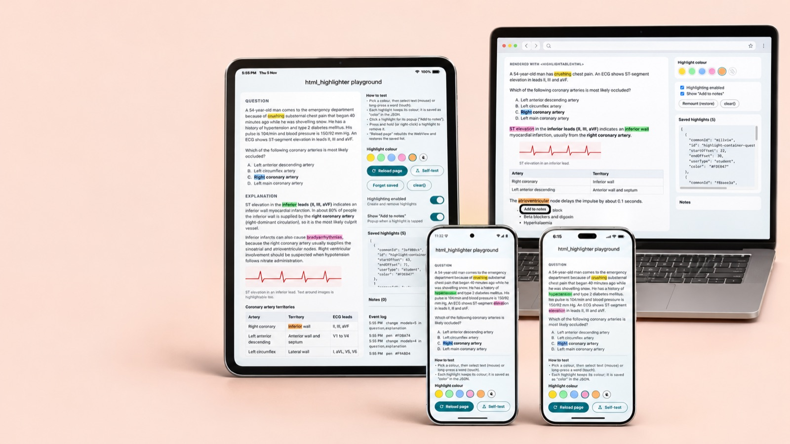
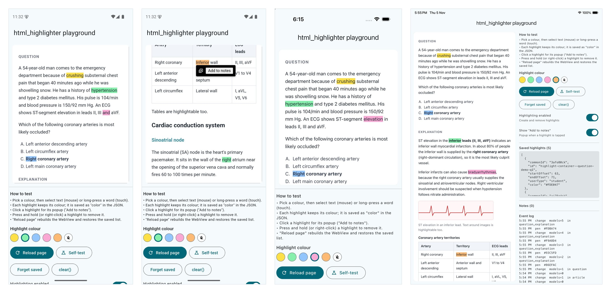
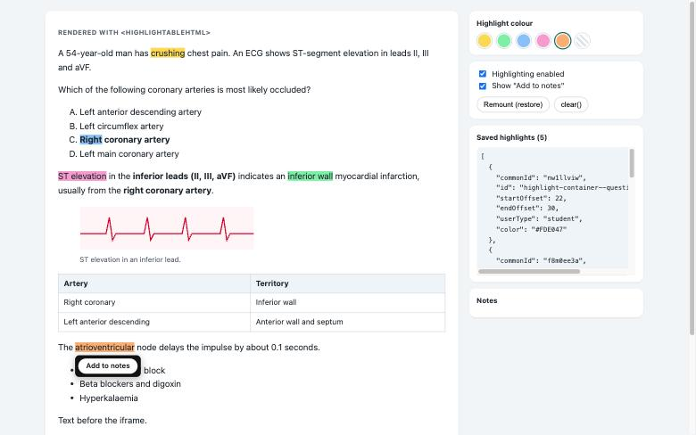

# html_highlighter

Persistent, multi-colour text highlighting for HTML shown in a
`webview_flutter` WebView. Users select text to highlight it, in any number of
highlights and colours. Tapping a highlight opens an "Add to notes" popup, and
a long-press (or right-click) removes it. Everything saves and restores as
JSON, colour included.

Drop it into any Flutter app that shows HTML in a WebView.

Source: [github.com/anjaneykumar7/html_highlighter](https://github.com/anjaneykumar7/html_highlighter)



**On the web** (plain JS, React, Next.js), use [`web/`](https://github.com/anjaneykumar7/html_highlighter/blob/main/web/README.md): the same
features and the same saved JSON, so highlights move between app and site.

## Contents

- [Platforms](#platforms) and [setup](#platform-setup)
- [Install](#install)
- [How it works in one minute](#how-it-works-in-one-minute)
- [1. Ready-made widget](#1-ready-made-widget)
- [2. Your own WebView: the bridge](#2-your-own-webview-the-bridge)
- [Turning things on and off](#turning-things-on-and-off)
- [Images, video and PDF](#images-video-and-pdf)
- [Colours](#colours-per-highlight)
- [What gets saved](#what-gets-saved)
- [Mouse / trackpad](#mouse--trackpad)
- [Known limitations](#known-limitations)
- [Playground app](#playground-app) and [tests](#tests)
- [Web version](#web-version)

## Platforms



*The playground app: Android, the "Add to notes" popup on Android, iPhone, and iPad with the saved JSON.*

| Platform | Status |
|---|---|
| iOS / iPadOS | Supported; tested on iPhone and iPad simulators with touch |
| macOS | Supported; tested with mouse and trackpad |
| Android | Supported; tested on an Android 35 emulator (Pixel 7) with touch |
| Web, Windows, Linux | Not supported by the Flutter package: `webview_flutter` can't run JavaScript or post messages back to Dart there. For web sites, use [`web/`](https://github.com/anjaneykumar7/html_highlighter/blob/main/web/README.md) |

`HighlightHost` lets you plug in your own renderer if you ever need another
platform.

## Install

```bash
flutter pub add html_highlighter
```

The package depends on `webview_flutter` `^4.14.1`.

## Platform setup

### iOS / iPadOS

- **The WebView must own the long-press gesture.** Otherwise native text
  selection never starts and nothing can be highlighted; the page sees the
  touch but logs "No range found". `HighlightableHtmlView` handles this by
  default with `defaultHighlightGestureRecognizers` (tap, long-press, drags,
  scale). If you pass your own `gestureRecognizers`, keep
  `LongPressGestureRecognizer` in it. If you build your own `WebViewWidget`,
  pass the same set.
- Recent Xcode versions need the iOS deployment target at **15.0** or higher
  (`ios/Podfile` and `Runner.xcodeproj`); the Flutter template uses 13.0.

### macOS

- A sandboxed macOS app shows a **blank WebView** unless it may make outgoing
  network connections. This applies even to local HTML. Add this to both
  `macos/Runner/DebugProfile.entitlements` and `Release.entitlements`:

  ```xml
  <key>com.apple.security.network.client</key>
  <true/>
  ```
- Recent Xcode versions need the macOS deployment target at **12.0** or
  higher; the Flutter template uses 10.15.
- `WebViewController.setBackgroundColor` isn't implemented on macOS.
  `HighlightableHtmlView` ignores that error; set your background in `addCss`.

## How it works in one minute

- Wrap each highlightable block of HTML in `highlightContainer(type:, id:,
  html:)`. A page can have **any number** of containers: a question, its
  explanation, article sections, all on one page if you like. Text outside
  containers can be selected but never highlighted, so put lists, tables,
  images and iframes inside one.
- Images and iframes (a video, a PDF) can sit inside a container; the text
  around them highlights as usual. An iframe's own content is a separate
  document and can't be highlighted.
- One engine, [`assets/highlighter.js`](https://github.com/anjaneykumar7/html_highlighter/blob/main/assets/highlighter.js), runs in the page. When the user
  highlights or removes something it sends the **whole** current list of
  highlights to Dart.
- Each highlight (a "model") has an owner, `userType`. Only `student`
  highlights are reported back and can be removed by the user.
- Each model's `id` is its container's DOM id
  (`highlight-container--question-…`), so you can tell where it lives.

## 1. Ready-made widget

```dart
HighlightableHtmlView(
  body: highlightContainer(type: 'article', id: section.id, html: section.html),
  highlightColor: const Color(0xFF86EFAC),     // colour for new highlights
  initialHighlights: savedModels,              // List<Map<String, dynamic>>
  onHighlightChanged: (change) => save(change.models),
  onAddToNote: (note) => createNote(note.cleanHtml),
  highlightingEnabled: canHighlight,           // change any time
  showAddToNote: notesEnabled,                 // change any time
  addCss: '.menu { display: none; }',
  addScripts: const [
    '<script>console.log("ready");</script>', // a full block…
    'window.myFlag = true;',                    // …or plain JS
  ],
  onCreated: (controller, bridge) => _bridge = bridge, // for clear() etc.
);
```

| Option | Default | Notes |
|---|---|---|
| `body` | required | HTML inside `<body>`; must contain container(s) |
| `initialHighlights` | `[]` | restored after load, each in its saved colour |
| `userType` | `'student'` | owner stamped on restored highlights |
| `highlightColor` | `null` | colour for new highlights; `null` = engine yellow, no `color` saved. Change any time |
| `highlightingEnabled` | `true` | `false`: users can't create or remove highlights; existing ones stay and still open their popup. Change any time |
| `showAddToNote` | `true` | `false`: tapping a highlight opens no "Add to notes" popup. Change any time |
| `onHighlightChanged` / `onAddToNote` | – | see [What gets saved](#what-gets-saved) |
| `onCreated` | – | gets the `WebViewController` and `HtmlHighlightBridge` |
| `onLoaded` / `onLoadError` | – | page finished (after restore) / resource error |
| `addCss` | `''` | your CSS, after the default styles, e.g. `'.menu { … }'` |
| `addScripts` | `[]` | your scripts, appended after the engine in order. Each entry is a full `<script>…</script>` block or plain JS (wrapped for you); blank entries are skipped |
| `head` | `''` | extra `<head>` markup (fonts, CDN scripts…) |
| `defaultStyles` | `true` | includes `highlightDefaultCss` before `addCss` |
| `mouseSelection` | `true` | includes the mouse shim |
| `gestureRecognizers` | `defaultHighlightGestureRecognizers` | keep long-press on iOS |
| `restoreDelay` | 800 ms | wait after load before restoring |
| `allowsInlineMediaPlayback` | `true` | iOS / macOS: video plays inside the page instead of only fullscreen. Read once, when the WebView is created |
| `backgroundColor`, `loadingBuilder` | – | `backgroundColor` is ignored on macOS |

Changing `body`, `head`, `addCss` or `addScripts` reloads the page; the
switches and `highlightColor` apply without a reload.

Inside a Flutter scroll view, pass your own `gestureRecognizers` without the
drag recognizers so the outer view can scroll. Keep the long-press one.

## 2. Your own WebView: the bridge

Use this when you build the HTML yourself.

```dart
final controller = WebViewController()
  ..setJavaScriptMode(JavaScriptMode.unrestricted);
final highlights = HtmlHighlightBridge(controller);

// a. Register channels BEFORE loading the page.
await highlights.attach(
  onHighlightChanged: (change) => save(change.models),
  onAddToNote: (note) => createNote(note.cleanHtml),
);

// b. Engine and helper scripts go AFTER your highlight containers.
final engineJs = await HighlighterScripts.load();
await controller.loadHtmlString('''
  <style>$highlightDefaultCss</style>
  ${highlightContainer(type: 'question', id: q.id, html: q.html)}
  ${highlightContainer(type: 'explanation', id: q.id, html: q.explanation)}
  <script>$engineJs</script>
  <script>$highlightColorLayerScript</script>                 <!-- per-highlight colours -->
  <script>${HighlighterScripts.mouseSelectionShim}</script>  <!-- mouse/trackpad -->
''');

// c. In onPageFinished (after a short delay):
await highlights.setHighlightColor(currentColor);   // optional
await highlights.restore(savedModels);
```

Or let `buildHighlightDocument(body:, engineJs:, head:, addCss:,
addScripts:)` build the full page in the right order: default CSS, your CSS,
the containers, the engine, the colour layer, the mouse shim, then your
scripts.

- **Channels:** `attach` only registers channels you pass a callback for
  (`onHighlightChanged`, `onAddToNote`, `onRestoreStatus`). Never also
  register `HighlightChangeChannel`, `AddToNoteChannel` or `HighlightChannel`
  yourself (names in `HighlightChannels`). iOS and macOS throw on duplicate
  channel names; Android silently replaces the first.
- **Styles:** the engine only adds a class (`highlight-text-student` /
  `highlight-text-admin`). Without `highlightDefaultCss` its highlights are
  invisible (unless they have a per-highlight colour). It also defines
  `.noselect`, which the engine adds when highlighting is turned off.
- **Gestures:** on iOS, give your `WebViewWidget`
  `defaultHighlightGestureRecognizers` (see [setup](#ios--ipados)).
- **Bridge methods:** `restore`, `setHighlightColor`,
  `setUserHighlightEnabled(bool)`, `setAddToNoteVisible(bool)`, `clear()`,
  `toggleStudyAssist()`, `runScript(js)`, and the `colors` book.

## Turning things on and off

| Widget option | Bridge method | Effect |
|---|---|---|
| `highlightingEnabled` | `setUserHighlightEnabled(bool)` | Off: no creating or removing highlights (touch or mouse), container text can't be selected. Existing highlights stay and still open their popup when tapped |
| `showAddToNote` | `setAddToNoteVisible(bool)` | Off: tapping a highlight shows nothing |
| – | `clear()` | Removes every highlight from the page. Your saved list is untouched |

The widget re-applies both switches every time the page loads.

## Images, video and PDF

Images and iframes can sit inside a container; the text around them
highlights as usual, and their own content (an iframe is a separate document)
can't be highlighted.

- **No highlights across media.** A selection that contains or crosses an
  iframe, video, audio, image, SVG, canvas, `object` or `embed` is cleared as
  soon as it forms and never becomes a highlight. Select the text on one side
  of it instead.

- **Images:** put them in a `<figure>` or `<div>`, not inside a `<p>`, or
  "Add to notes" HTML leaves them out.
- **Video:** give the iframe a small page holding
  `<video controls playsinline src="…">` (an iframe `srcdoc`), and keep
  `allowsInlineMediaPlayback` on (the default). An iframe whose `src` is the
  `.mp4` itself opens a bare media document that never started on iOS.
- **PDF:** iOS WKWebView doesn't draw a PDF inside an iframe. Give the iframe
  a page that renders the PDF with [pdf.js](https://mozilla.github.io/pdf.js/)
  instead. pdf.js fetches the file, so its server must allow cross-origin
  reads (CORS: `Access-Control-Allow-Origin`).
- WebKit may hold off work in iframes that are off screen, so a PDF can
  render only when it scrolls into view.

`example/lib/sample_content.dart` has ready-to-copy `videoFrame(url)` and
`pdfFrame(url)` helpers (playground code, not package API).

## Colours (per highlight)

Every highlight can have its own colour, stored in its model.

- Set the colour for **new** highlights with `highlightColor` (widget) or
  `bridge.setHighlightColor(color)`. Change it at any time; existing
  highlights keep theirs, so users can mix any number of colours.
- `restore()` re-applies each model's `color`. Models without one stay the
  engine's default yellow and are never recoloured.
- `null` means the engine default yellow, and no `color` is saved.
- Colours are CSS hex: `#RRGGBB`, or `#RRGGBBAA` with alpha. Convert with
  `highlightColorToCss(Color)` and `highlightColorFromCss(String)`.
- How it works: the engine knows nothing about colour, so a page-side colour
  layer paints highlights by `commonId`, and the bridge adds `"color"` to
  models. See `CONTEXT.md`.

## What gets saved

`HighlightChange.models` is a list of maps:

```json
{
  "commonId": "ie878at3",
  "id": "highlight-container--question-demo-q1",
  "startOffset": 387,
  "endOffset": 390,
  "color": "#86EFAC",
  "userType": "student"
}
```

| Field | Meaning |
|---|---|
| `commonId` | highlight id (random, per highlight) |
| `id` | container DOM id, `highlight-container--<type>-<id>` |
| `startOffset` / `endOffset` | character offsets into the container's text |
| `color` | optional; only when a colour was set |
| `userType` | owner (`student`, `admin`, `ops`) |

- Store the list as JSON and pass it back to `restore`.
- Each change message carries the **whole** current list, not a diff.
- Offsets only line up if the container's HTML hasn't changed.
- `restore` stamps its `userType` (default `student`) on every model, so
  models saved without one still restore.

`HighlightNoteRequest.cleanHtml` is the selected HTML with highlight
backgrounds stripped, ready for a note.

## Mouse / trackpad

The engine is touch-driven: a highlight starts on `touchend` and is removed by
a long-press. A mouse fires neither. `HighlighterScripts.mouseSelectionShim`
bridges this (touch input is ignored, so nothing fires twice):

- finish a left-button selection inside a container → highlight is created
- press and hold a highlight for 350 ms → highlight is removed
- right-click a highlight → removed (the engine's own handler, where the host
  delivers right-clicks)

`HighlightableHtmlView` and `buildHighlightDocument` add it by default.

## Known limitations

- **Whole-paragraph selections are ignored.** A triple-click, or a drag to the
  very end of a paragraph, ends the selection at the start of the next
  element, and the engine treats that as empty. This is rare with touch
  selection.
- **Restored highlights are drawn twice.** The restore runs again after
  150 ms, which nests duplicate spans. The saved models aren't duplicated and
  solid colours look the same, but semi-transparent colours look darker.
  `restore(reapplyAfter:)` changes the delay but can't turn the second pass
  off.
- **One popup rule for all containers.** "Add to notes" shows for every
  container, question ones included; turn it off with `showAddToNote`.
- **Images inside `<p>` are left out of note HTML.** When building "Add to
  notes" HTML the engine drops any `` or `<p>` whose parent is a `<p>`.
  Put images in a `<figure>` or `<div>` instead.
- **iOS won't draw a PDF in an iframe pointed straight at it**, and an iframe
  pointed straight at an `.mp4` didn't play on the iOS simulator. See
  [Images, video and PDF](#images-video-and-pdf) for the setup that works.
- **iOS: the first touch after an existing selection only dismisses it.** If
  text is already selected (for example right after a highlight is created,
  or after the playground's self-test), iOS uses the next touch to clear that
  selection, so a long-press there may not create a highlight. Holding again
  works.

## Playground app

`example/` is a Flutter app (Android, iOS, macOS) for trying everything: one
page with question, explanation and article sections (lists, tables, an image,
and a playing video and a rendered PDF in iframes), a colour picker, the on/off switches,
`clear()`, notes, press-and-hold removal, "Reload page" to check restore, the
saved JSON, an event log, a JS console, and an `addCss` / `addScripts` demo
(which also logs whether each iframe loaded).

```bash
cd example
flutter run -d macos
flutter run -d <ipad-simulator-id>                 # iOS / iPadOS
flutter run -d macos --dart-define=SELF_TEST=true  # automated check on start
```

The **Self-test** button (or `SELF_TEST`) runs these checks inside the real
WebView and prints `SELFTEST … PASS/FAIL`: create, colour, popup after create,
press-and-hold removal, a list item, a table cell, text next to an image and
text next to an iframe, and that a selection across an iframe is blocked. It
uses synthetic mouse events, so on iOS also try real
touch by hand. See `example/README.md`.

Logs: the page's console goes to the "JS console" panel and to stdout as
`[js] …`, and app events print as `[event] …`. On the iOS simulator the
`flutter run` output lags behind the app, so trust the **in-app event log**
when judging whether a tap worked.

## Tests

```bash
flutter test            # package
cd example && flutter test
```

See `CONTEXT.md` for how it works and `AGENTS.md` for rules when changing it.

## Web version

[`web/`](https://github.com/anjaneykumar7/html_highlighter/blob/main/web/README.md) is a separate JavaScript module for web pages: a
framework-agnostic `highlighter.js` plus `react.js` (`HighlightableHtml`,
`useHighlighter`, `"use client"` for Next.js). It has every feature above
(colours, owners, the "Add to notes" popup, press-and-hold and right-click
removal, merging, restore, `clear()`, the on/off switches, the touch guard and
the no-selection-across-media rule) and saves the same JSON. It is
independent of the Flutter code: no Dart, no WebView. See its README.



Files: [`highlighter.js`](https://github.com/anjaneykumar7/html_highlighter/blob/main/web/highlighter.js) ·
[`react.js`](https://github.com/anjaneykumar7/html_highlighter/blob/main/web/react.js) ·
[`Highlighter.css`](https://github.com/anjaneykumar7/html_highlighter/blob/main/web/Highlighter.css) ·
[`highlighter.d.ts`](https://github.com/anjaneykumar7/html_highlighter/blob/main/web/highlighter.d.ts).

With a mouse, the web version also opens the popup on **hover** and removes a
highlight on **click** (`popupOnHover`, `clickToRemove`); taps behave as in
the app. The Flutter package doesn't have these (in the app a click opens the
popup).

```bash
cd web && npm install && npm test
```


## License

MIT. See [LICENSE](https://github.com/anjaneykumar7/html_highlighter/blob/main/LICENSE).
